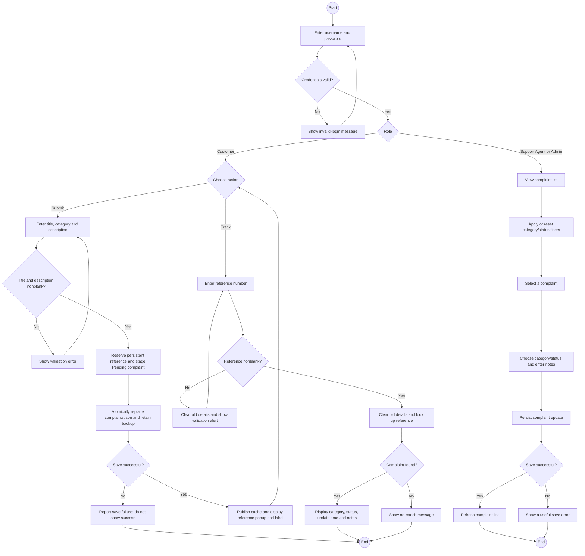

# Complaint lifecycle activity diagram

Status: **Draft based on the current implementation; team review pending.**
Prepared: 27 November 2026.

The diagram follows the integrated Customer and Support Agent flows. Administrators use the support workspace; account management and ticket summaries remain a scope decision. The editable activity page is included in [design.drawio](design.drawio), with a [PNG export](exports/09-activity.png). This technical refresh does not imply additional team approval.

## Review notes

- Cached changes now publish only after successful persistence. Failure-injection checks confirm that failed writes preserve the prior cache and primary file.
- Blank tracking input has its own alert. Rejected submissions clear any previous success reference.
- Successful submissions display both the returned reference label and a confirmation message. The automated UI suite records the message call; a human must still confirm actual dialog usability.
- Administrator-specific account management and summary actions remain outside the implemented flows pending a team scope decision.
