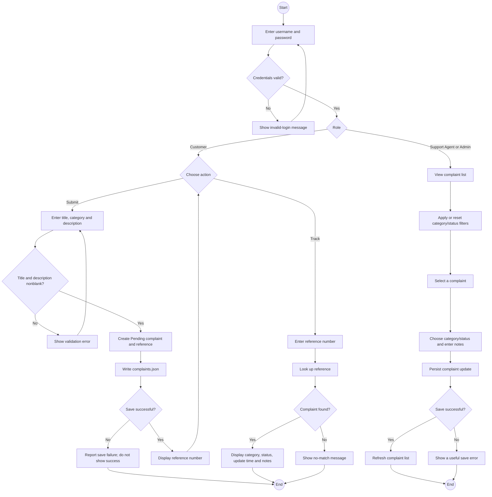

# Complaint lifecycle activity diagram

Status: **Draft based on the current implementation; team review pending.**
Prepared: 27 November 2026.

The diagram follows the implemented Customer and Support Agent flows. Administrators are routed to the support workspace, but account management and ticket summaries are not implemented. Persistence-error branches describe the required response; the current UI does not handle every storage error gracefully.

## Review notes

- The diagram records the intended save-failure outcome separately from demonstrated behavior. The backend mutates cached records before attempting to save; a failed write can leave in-memory state changed.
- Blank tracking input currently follows the no-match path rather than showing a dedicated validation alert.
- A successful customer submission currently displays the reference in the form; a separate confirmation dialog is not shown.
- Administrator-specific account management and summary actions remain outside the implemented flows pending a team scope decision.
